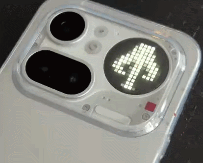

# Toyph



Toyph is an Android Glyph Toy for Nothing phones. It reads
`app/src/main/assets/toy-config.json` and renders glyphs, scrolling text,
effects, transitions, and filters on the 13x13 Glyph Matrix.

# Make your first Toyph

If this is your first time here, follow this order:

1. Edit `toy-config.json`
2. Reuse or create glyphs
3. Reuse or create a font
4. Add effects and filters
5. Install the app on your phone

## 1. Edit `toy-config.json`

Toyph decides what to show from this file:

`app/src/main/assets/toy-config.json`

This is the actual `toy-config.json` currently checked into the repository:

```json
{
  "version": "1.0.0",
  "defaultTransition": {
    "type": "fade",
    "durationMs": 1000,
    "frameIntervalMs": 50
  },
  "sequence": [
    { "type": "glyph", "path": "glyphs/mandalorian.json", "brightness": 0.5, "displayDurationMs": 10000 },
    { "type": "scrolling_text", "text": "This is the way", "font": "fonts/auraboo.json", "brightness": 0.5, "frameIntervalMs": 50 },
    { "type": "glyph", "path": "glyphs/rebel.json", "brightness": 0.5, "displayDurationMs": 10000 }
  ],
  "effects": [
    { "type": "TRIPLE_SCANLINE", "frameIntervalMs": 50, "trailingIntervalMs": 3000 },
    { "type": "GLITCH_TEAR", "frameIntervalMs": 80, "trailingIntervalMs": 3000 }
  ],
  "filters": [
    { "type": "pip_boy", "value": 0.8 }
  ]
}
```

What each part means:

- `sequence` = ordered list of items shown on screen. Each item has a required `type` and supports an optional `transition` override.
  - `glyph` item parameters:
    - `type` (required): must be `"glyph"`
    - `path` (required): glyph JSON path under `assets`, for example `glyphs/rebel.json`
    - `brightness` (optional): `0.0..1.0`, default `1.0`
    - `displayDurationMs` (optional): milliseconds to keep the glyph on screen, default `5000`
    - `transition` (optional): same object shape as `defaultTransition`
  - `scrolling_text` item parameters:
    - `type` (required): must be `"scrolling_text"`
    - `text` (required): text to render
    - `font` (required): font JSON path under `assets`, for example `fonts/auraboo.json`
    - `brightness` (optional): `0.0..1.0`, default `1.0`
    - `frameIntervalMs` (optional): milliseconds per scroll frame, default `80` (lower = faster)
    - `transition` (optional): same object shape as `defaultTransition`
- `defaultTransition` = fallback transition for sequence item changes.
  - Parameters: `type` (`fade` or `none`), `durationMs` (default `1000`), `frameIntervalMs` (default `50`, clamped to at least `30`)
- `effects` = optional animated overlay list.
  - Each effect uses: `type` (required), `frameIntervalMs` (required, clamped to at least `30`), `trailingIntervalMs` (optional rest delay, default `0`)
- `filters` = optional final visual look list.
  - Available filter parameters:
    - `brightness`: requires `value` in `0.0..1.0`
    - `dead_pixels`: requires `pixels` as `[[row, col], ...]` (zero-based)
    - `blur`: no extra parameters
    - `pip_boy`: optional `value` in `0.0..1.0` (default `0.8`)

If `sequence`, `effects`, or `filters` is missing from the file, Toyph treats
that section as an empty list.

**Fastest first edit:** keep the bundled glyphs and font, change only the text,
effects, or filters, then install the app.

## 2. Reuse or create glyphs

### Easiest option

As it is released for before May the 4th, the vibes are with droids we are looking for.

Use one of the glyph JSON files already in the repo, for example:

- `glyphs/mandalorian.json`
- `glyphs/rebel.json`

### Make your own glyph

1. Open the web editor:
   https://antonvidishchev.github.io/nothing-toyph-notifications/
2. Draw your 13x13 glyph
3. Export it as JSON
4. Save the file into:
   `app/src/main/assets/glyphs/`
5. Reference it in `toy-config.json`:

```json
{
  "type": "glyph",
  "path": "glyphs/myglyph.json",
  "brightness": 1.0,
  "displayDurationMs": 10000
}
```

## 3. Reuse or create a font

### Easiest option

Use one of the fonts already in the repo:

- `fonts/auraboo.json`
- `fonts/default.json`

The bundled `Auraboo` source font in `tools/Auraboo.otf` comes from the
[AurekFonts Auraboo archive](https://github.com/AurekFonts/AurekFonts.github.io/tree/master/Auraboo).
Upstream credits it to **Nick Tierce**, and the upstream `readme.txt` says:
**"This font is Free for All Personal and Commercial Uses."**

### Make your own font

1. Install Python if you do not already have it
2. Install Pillow:

```bash
python -m pip install Pillow
```

3. Convert a `.ttf` or `.otf` font into Toyph JSON:

```bash
python tools/font-to-glyph.py --input tools/Auraboo.otf --output app/src/main/assets/fonts/myfont.json --name myfont --char-height 11 --top-margin 1 --bottom-margin 1 --spacing 1
```

4. Reference the generated font in `toy-config.json`:

```json
{
  "type": "scrolling_text",
  "text": "HELLO GLYPH",
  "font": "fonts/myfont.json",
  "brightness": 1.0,
  "frameIntervalMs": 80
}
```

**Important:** `charHeight + topMargin + bottomMargin` should add up to `13`
so the text fits the 13-row display.

If you want more font-tool options, see [tools/README.md](tools/README.md).

## 4. Add effects and filters

You can keep these arrays empty, but the easiest nice-looking setup is to add
one effect and one filter.

### Available effects

| Type | What it does |
|------|---------------|
| `SCANLINE` | Single bright row sweep |
| `TRIPLE_SCANLINE` | Three-row sweep |
| `CRT_SHIMMER` | Alternating CRT-like shimmer |
| `PHOSPHOR_TRAIL` | Sweeping bright trail |
| `GLITCH_TEAR` | Short horizontal glitch movement |

### Available filters

| Type | What it does |
|------|---------------|
| `brightness` | Global brightness multiplier |
| `dead_pixels` | Turns specific pixels off |
| `blur` | Soft blur |
| `pip_boy` | Retro green-style look |

Example:

```json
"effects": [
  { "type": "TRIPLE_SCANLINE", "frameIntervalMs": 50, "trailingIntervalMs": 3000 }
],
"filters": [
  { "type": "pip_boy", "value": 0.8 }
]
```

## 5. Install Toyph on your phone

You do **not** need to add a real Nothing API key just to try Toyph locally.
This repository already uses Nothing's documented debug value `test`.

### 1. Install Android Studio

If you do not have Android Studio yet, start here:

- [Download Android Studio](https://developer.android.com/studio)
- [Android Studio installation guide](https://developer.android.com/studio/install)

### 2. Enable developer mode and USB debugging on your phone

Use the official guide:

- [Enable developer options and USB debugging](https://developer.android.com/studio/debug/dev-options)

On most phones that means:

1. Open **Settings**
2. Open **About phone**
3. Tap **Build number** seven times
4. Go back to **Developer options**
5. Turn on **USB debugging**

### 3. Clone the repository

```bash
git clone https://github.com/<your-user>/toyph.git
cd toyph
```

### 4. Open the project in Android Studio

Open the `toyph` folder and let Android Studio finish loading and syncing.

If Android Studio asks to install SDK components or accept Gradle settings,
accept those prompts.

### 5. Connect the phone

1. Unlock the phone
2. Connect it with a USB cable
3. Accept the **Allow USB debugging** prompt if it appears

### 6. Build and install

From the repository root, run:

```bash
# Windows
gradlew.bat installDebug

# macOS / Linux
./gradlew installDebug
```

### 7. If Glyph debug access is still blocked

Nothing's Glyph developer docs say you can enable debug access with:

```bash
adb shell settings put global nt_glyph_interface_debug_enable 1
```

This debug mode automatically turns off after 48 hours.

### 8. Turn Toyph on in phone settings

On the phone, open:

**Settings -> Glyph Interface -> Flip to Glyph -> Always-on Glyph Toy**

Then choose **Toyph** from the list.

### 9. Change and redeploy

After you edit `toy-config.json`, glyphs, fonts, or code, run `installDebug`
again to update the app on the phone.

### 10. If you want several Toyphs installed at the same time

If you install Toyph again with the same app ID, Android replaces the old one.
To keep multiple Toyph variants on the phone at once, each build needs:

- a different **Android app ID**
- a different visible **toy name**

#### Change the app ID

Edit `app/build.gradle.kts` and change:

```kotlin
applicationId = "com.toyph.app"
```

to something unique, for example:

```kotlin
applicationId = "com.toyph.app.mando"
```

#### Change the visible Toy name

Edit `app/src/main/res/values/strings.xml` and change:

```xml
<string name="toy_name">Toyph</string>
```

to something unique, for example:

```xml
<string name="toy_name">Toyph Mando</string>
```

You can also change `toy_summary` in the same file if you want the entry in the
Glyph Toy list to be easier to tell apart.

Then build and install again. Repeat with a new app ID and name for each extra
Toyph variant.


## Detailed deployment notes

| Requirement | Notes |
|-------------|-------|
| Android Studio or JDK 17 | Android Studio is the easiest setup path |
| Nothing Phone (4a) Pro | Current target hardware |
| USB cable | Needed to install from your computer |
| Real Nothing API key | Not required for local debug because this repo already uses `test` |
| Python 3.8+ | Needed only for font generation tools |
| Pillow | Needed only for `tools/font-to-glyph.py` |

## Project structure

```text
app/
  libs/
    glyph-matrix-sdk-2.0.aar
  src/main/
    AndroidManifest.xml
    assets/
      fonts/
      glyphs/
      toy-config.json
    java/com/toyph/app/
      GlyphToyService.kt
      ToyConfig.kt
      effects/
      filters/
      pipeline/
      sequence/
      transitions/
      util/
    res/
tools/
  font-to-glyph.py
  generate-test-font.py
```

## Development notes

- Every frame is a `13 x 13` matrix flattened to `IntArray(169)`
- Frame intervals must stay at or above `30ms`
- Emulators do not support the GlyphMatrix SDK, so visual verification requires
  a physical device

## Contributing

See [CONTRIBUTING.md](CONTRIBUTING.md) for contribution guidance for effects,
filters, glyph assets, docs, and pipeline changes.

## License

Toyph is released under the **MIT License**.

- Copyright (c) 2026 Anton Vidishchev
- See [LICENSE](LICENSE) for the full license text
- The bundled `Auraboo` font source in `tools/Auraboo.otf` is attributed to
  **Nick Tierce** via the
  [AurekFonts Auraboo archive](https://github.com/AurekFonts/AurekFonts.github.io/tree/master/Auraboo).
  According to the upstream `Auraboo/readme.txt`, the font is **"Free for All
  Personal and Commercial Uses."**
- The bundled GlyphMatrix SDK AAR remains subject to Nothing Technology's own
  license terms
